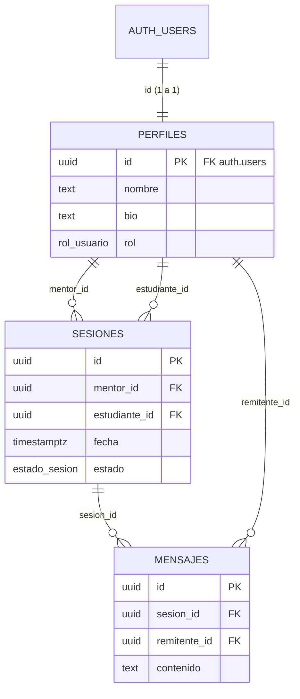

# MentorLink · Infraestructura con Supabase e IA

**Proyecto Integrador:** implementación de infraestructura con Supabase e IA
**Rol:** Arquitecto IA · **Stack:** PostgreSQL (Supabase), Supabase Auth, Supabase CLI 3.1.0

| # | Entregable | Sección |
|---|---|---|
| 1 | Scripts SQL generados (tablas + RLS) | [1. Scripts SQL](#1-scripts-sql-generados) |
| 2 | Prompt de IA utilizado | [2. Prompt de IA](#2-prompt-de-ia-utilizado) |
| 3 | Log de comandos de la CLI de Supabase | [3. Supabase CLI](#3-log-de-comandos-de-supabase-cli) |
| 4 | Guía de configuración de Auth (Google) | [4. Guía Auth](#4-guía-de-configuración-auth) |
| + | Evidencia: pruebas de RLS en PostgreSQL | [5. Verificación](#5-verificación-del-sql-y-las-políticas-rls) |

---

## 1. Scripts SQL generados

Archivo: [`supabase/migrations/20261111020304_inicializar_esquema.sql`](../supabase/migrations/20261111020304_inicializar_esquema.sql)

### Modelo de datos



### Decisiones de diseño

| Decisión | Motivo |
|---|---|
| `perfiles.id` = FK a `auth.users(id)` | Supabase Auth gestiona las credenciales y `perfiles` solo guarda datos de la app. `ON DELETE CASCADE` limpia todo si se borra la cuenta. |
| `ENUM` para `rol` y `estado` | Valores cerrados que se validan en la base de datos, no en el frontend. |
| `uuid` + `gen_random_uuid()` | Los IDs no se pueden adivinar, a diferencia de un `serial`. |
| `timestamptz` en `fecha` | Mentores y estudiantes pueden estar en distintas zonas horarias. |
| `CHECK (mentor_id <> estudiante_id)` y `UNIQUE (mentor_id, fecha)` | Impiden sesiones con uno mismo y dos sesiones del mismo mentor a la misma hora. |
| Trigger `handle_new_user` | Crea el perfil al registrarse (email o Google). El rol **nunca** viene del cliente. |
| Trigger `validar_roles_sesion` | Garantiza que `mentor_id` tenga rol mentor y `estudiante_id` rol estudiante. |
| Privilegios por columna | Solo se pueden editar `nombre`/`bio` y `fecha`/`estado`, lo que impide que alguien cambie su propio rol para escalar privilegios. |
| Mensajes sin `UPDATE`/`DELETE` | El historial del chat es inmutable. |

### Políticas RLS (resumen)

| Tabla | Operación | Quién puede | Política |
|---|---|---|---|
| perfiles | SELECT | Cualquier usuario autenticado | `using (true)`: directorio de mentores |
| perfiles | UPDATE | Solo el dueño (solo `nombre`, `bio`) | `auth.uid() = id` |
| sesiones | SELECT | Mentor o estudiante de la sesión | `auth.uid() in (mentor_id, estudiante_id)` |
| sesiones | INSERT | El estudiante, para sí mismo, en estado `pendiente` | `auth.uid() = estudiante_id and estado = 'pendiente'` |
| sesiones | UPDATE | Participantes (solo `fecha`, `estado`) | `auth.uid() in (mentor_id, estudiante_id)` |
| mensajes | SELECT | Participantes de la sesión | `es_participante(sesion_id)` |
| mensajes | INSERT | Participante, en nombre propio | `auth.uid() = remitente_id and es_participante(sesion_id)` |
| todas | todas | `anon` (sin sesión) | Sin acceso (`revoke all`) |

### Código SQL completo

```sql
-- =============================================================================
-- MentorLink · Migración: inicializar_esquema
-- Creada con: supabase migration new inicializar_esquema
-- Contenido: tipos, tablas (perfiles, sesiones, mensajes), índices, triggers
--            y políticas RLS.
-- =============================================================================

-- -----------------------------------------------------------------------------
-- 1. TIPOS ENUMERADOS
-- -----------------------------------------------------------------------------
create type public.rol_usuario as enum ('mentor', 'estudiante');

create type public.estado_sesion as enum ('pendiente', 'confirmada', 'completada', 'cancelada');

-- -----------------------------------------------------------------------------
-- 2. TABLAS
-- -----------------------------------------------------------------------------

-- perfiles: 1 a 1 con auth.users (Supabase Auth gestiona email/contraseña/OAuth)
create table public.perfiles (
  id          uuid primary key references auth.users (id) on delete cascade,
  nombre      text not null check (char_length(trim(nombre)) between 2 and 100),
  bio         text check (char_length(bio) <= 1000),
  rol         public.rol_usuario not null default 'estudiante',
  created_at  timestamptz not null default now(),
  updated_at  timestamptz not null default now()
);

comment on table public.perfiles is 'Datos públicos de cada usuario. id = auth.users.id';

-- sesiones: una mentoría agendada entre un mentor y un estudiante
create table public.sesiones (
  id             uuid primary key default gen_random_uuid(),
  mentor_id      uuid not null references public.perfiles (id) on delete cascade,
  estudiante_id  uuid not null references public.perfiles (id) on delete cascade,
  fecha          timestamptz not null,
  estado         public.estado_sesion not null default 'pendiente',
  created_at     timestamptz not null default now(),
  updated_at     timestamptz not null default now(),
  constraint sesiones_participantes_distintos check (mentor_id <> estudiante_id),
  -- un mentor no puede tener dos sesiones a la misma hora
  constraint sesiones_mentor_fecha_unica unique (mentor_id, fecha)
);

comment on table public.sesiones is 'Mentorías entre un mentor y un estudiante';

-- mensajes: chat dentro de una sesión (inmutables: no se editan ni borran)
create table public.mensajes (
  id            uuid primary key default gen_random_uuid(),
  sesion_id     uuid not null references public.sesiones (id) on delete cascade,
  remitente_id  uuid not null references public.perfiles (id) on delete cascade,
  contenido     text not null check (char_length(trim(contenido)) between 1 and 2000),
  created_at    timestamptz not null default now()
);

comment on table public.mensajes is 'Mensajes del chat de cada sesión';

-- -----------------------------------------------------------------------------
-- 3. ÍNDICES (FKs y columnas usadas por las políticas RLS)
-- -----------------------------------------------------------------------------
create index sesiones_mentor_id_idx     on public.sesiones (mentor_id);
create index sesiones_estudiante_id_idx on public.sesiones (estudiante_id);
create index sesiones_fecha_idx         on public.sesiones (fecha);
create index mensajes_sesion_id_idx     on public.mensajes (sesion_id, created_at);
create index mensajes_remitente_id_idx  on public.mensajes (remitente_id);

-- -----------------------------------------------------------------------------
-- 4. FUNCIONES Y TRIGGERS
-- -----------------------------------------------------------------------------

-- 4.1 Mantener updated_at
create or replace function public.set_updated_at()
returns trigger
language plpgsql
set search_path = ''
as $$
begin
  new.updated_at := now();
  return new;
end;
$$;

create trigger perfiles_set_updated_at
  before update on public.perfiles
  for each row execute function public.set_updated_at();

create trigger sesiones_set_updated_at
  before update on public.sesiones
  for each row execute function public.set_updated_at();

-- 4.2 Crear el perfil automáticamente al registrarse (email o Google).
--     Google envía "full_name"/"name" en raw_user_meta_data; el registro por
--     email puede enviar "nombre" en options.data. Nunca se acepta el rol
--     desde el cliente: siempre empieza como 'estudiante'.
create or replace function public.handle_new_user()
returns trigger
language plpgsql
security definer
set search_path = ''
as $$
begin
  insert into public.perfiles (id, nombre)
  values (
    new.id,
    coalesce(
      nullif(trim(new.raw_user_meta_data ->> 'nombre'), ''),
      nullif(trim(new.raw_user_meta_data ->> 'full_name'), ''),
      nullif(trim(new.raw_user_meta_data ->> 'name'), ''),
      split_part(new.email, '@', 1)
    )
  );
  return new;
end;
$$;

create trigger on_auth_user_created
  after insert on auth.users
  for each row execute function public.handle_new_user();

-- 4.3 Validar que mentor_id sea mentor y estudiante_id sea estudiante
create or replace function public.validar_roles_sesion()
returns trigger
language plpgsql
security definer
set search_path = ''
as $$
begin
  if not exists (select 1 from public.perfiles where id = new.mentor_id and rol = 'mentor') then
    raise exception 'mentor_id (%) no corresponde a un perfil con rol mentor', new.mentor_id;
  end if;
  if not exists (select 1 from public.perfiles where id = new.estudiante_id and rol = 'estudiante') then
    raise exception 'estudiante_id (%) no corresponde a un perfil con rol estudiante', new.estudiante_id;
  end if;
  return new;
end;
$$;

create trigger sesiones_validar_roles
  before insert or update of mentor_id, estudiante_id on public.sesiones
  for each row execute function public.validar_roles_sesion();

-- 4.4 Función auxiliar para RLS: ¿el usuario actual participa en la sesión?
--     SECURITY DEFINER evita evaluar RLS anidado y mejora el rendimiento.
create or replace function public.es_participante(p_sesion_id uuid)
returns boolean
language sql
stable
security definer
set search_path = ''
as $$
  select exists (
    select 1
    from public.sesiones s
    where s.id = p_sesion_id
      and (select auth.uid()) in (s.mentor_id, s.estudiante_id)
  );
$$;

-- Las funciones de trigger no deben poder llamarse vía API (/rest/v1/rpc)
revoke execute on function public.handle_new_user()      from public, anon, authenticated;
revoke execute on function public.validar_roles_sesion() from public, anon, authenticated;
revoke execute on function public.es_participante(uuid)  from public, anon;
grant  execute on function public.es_participante(uuid)  to authenticated;

-- -----------------------------------------------------------------------------
-- 5. PRIVILEGIOS (defensa en profundidad, además de RLS)
-- -----------------------------------------------------------------------------
-- anon (sin sesión) no accede a nada
revoke all on public.perfiles, public.sesiones, public.mensajes from anon;

-- perfiles: solo se pueden editar nombre y bio (el rol NO, evita escalar privilegios)
revoke insert, update, delete on public.perfiles from authenticated;
grant  select on public.perfiles to authenticated;
grant  update (nombre, bio) on public.perfiles to authenticated;

-- sesiones: se crean y se actualizan fecha/estado; no se borran (se cancelan)
revoke update, delete on public.sesiones from authenticated;
grant  select, insert on public.sesiones to authenticated;
grant  update (fecha, estado) on public.sesiones to authenticated;

-- mensajes: solo lectura e inserción (historial inmutable)
revoke update, delete on public.mensajes from authenticated;
grant  select, insert on public.mensajes to authenticated;

-- -----------------------------------------------------------------------------
-- 6. ROW LEVEL SECURITY
--    Patrón (select auth.uid()) => Postgres lo evalúa una sola vez por consulta.
-- -----------------------------------------------------------------------------
alter table public.perfiles enable row level security;
alter table public.sesiones enable row level security;
alter table public.mensajes enable row level security;

-- ---------- perfiles ----------
-- Cualquier usuario autenticado puede ver perfiles (necesario para buscar mentores).
create policy "perfiles: autenticados pueden ver perfiles"
  on public.perfiles for select
  to authenticated
  using (true);

-- Cada usuario solo puede editar su propio perfil.
create policy "perfiles: el usuario edita su propio perfil"
  on public.perfiles for update
  to authenticated
  using ((select auth.uid()) = id)
  with check ((select auth.uid()) = id);

-- ---------- sesiones ----------
-- Solo los participantes (mentor o estudiante) ven la sesión.
create policy "sesiones: participantes pueden ver sus sesiones"
  on public.sesiones for select
  to authenticated
  using ((select auth.uid()) in (mentor_id, estudiante_id));

-- Un estudiante solo puede solicitar sesiones para sí mismo y en estado pendiente.
create policy "sesiones: el estudiante solicita su propia sesion"
  on public.sesiones for insert
  to authenticated
  with check (
    (select auth.uid()) = estudiante_id
    and estado = 'pendiente'
  );

-- Solo los participantes pueden modificar (reprogramar, confirmar, cancelar).
create policy "sesiones: participantes actualizan sus sesiones"
  on public.sesiones for update
  to authenticated
  using ((select auth.uid()) in (mentor_id, estudiante_id))
  with check ((select auth.uid()) in (mentor_id, estudiante_id));

-- ---------- mensajes ----------
-- Solo los participantes de la sesión leen sus mensajes.
create policy "mensajes: participantes leen los mensajes de su sesion"
  on public.mensajes for select
  to authenticated
  using (public.es_participante(sesion_id));

-- Solo se envía en nombre propio y dentro de una sesión en la que se participa.
create policy "mensajes: participantes envian mensajes en su sesion"
  on public.mensajes for insert
  to authenticated
  with check (
    (select auth.uid()) = remitente_id
    and public.es_participante(sesion_id)
  );
```

---

## 2. Prompt de IA utilizado

Texto exacto enviado al asistente de IA (Claude) para generar el SQL de la migración y las políticas RLS.

```text
## ROL
Actúa como Arquitecto de Bases de Datos Senior especializado en PostgreSQL 15+ y Supabase
(Auth, RLS, CLI). Escribes SQL de producción: seguro por defecto, idempotente donde aplique
y comentado en español.

## CONTEXTO
Proyecto: "MentorLink", plataforma que conecta mentores expertos en tecnología con estudiantes.
- La autenticación la gestiona Supabase Auth (Email/Password y Google OAuth); los usuarios
  viven en auth.users.
- El SQL se guardará en una migración creada con `supabase migration new inicializar_esquema`
  y se aplicará con `supabase db push`.
- Presupuesto limitado: nada de extensiones de pago ni servicios externos.

## TAREA
Genera UN script SQL que cree:
1. perfiles (id, nombre, bio, rol): id es PK y FK a auth.users(id) ON DELETE CASCADE.
   rol es un ENUM ('mentor', 'estudiante') con valor por defecto 'estudiante'.
2. sesiones (id, mentor_id, estudiante_id, fecha, estado): mentor_id y estudiante_id son FK a
   perfiles. estado es un ENUM ('pendiente', 'confirmada', 'completada', 'cancelada').
3. mensajes (id, sesion_id, remitente_id, contenido): FK a sesiones y a perfiles.

## REQUISITOS TÉCNICOS
- Tipos óptimos: uuid con gen_random_uuid(), timestamptz para fechas, text con CHECK de longitud.
- Restricciones: NOT NULL donde corresponda, CHECK mentor_id <> estudiante_id, UNIQUE
  (mentor_id, fecha) para evitar choques de horario y contenido de mensajes no vacío (máx. 2000).
- Índices en todas las FK y en las columnas que usan las políticas RLS.
- created_at/updated_at con un trigger que mantenga updated_at.
- Trigger en auth.users que cree el perfil automáticamente al registrarse, tomando el nombre de
  raw_user_meta_data ('nombre' para email, 'full_name' o 'name' para Google). El rol NUNCA
  se toma del cliente.
- Trigger que valide que mentor_id tenga rol 'mentor' y estudiante_id rol 'estudiante'.
- Todas las funciones SECURITY DEFINER deben usar `set search_path = ''`.

## SEGURIDAD (RLS)
Habilita RLS en las 3 tablas y crea políticas para el rol `authenticated`:
- perfiles: SELECT para cualquier autenticado (directorio de mentores); UPDATE solo del propio
  perfil. El usuario NO puede cambiar su rol (usa privilegios de columna).
- sesiones: SELECT/UPDATE solo si auth.uid() es mentor_id o estudiante_id. INSERT solo si
  auth.uid() = estudiante_id y estado = 'pendiente'. Sin DELETE (se cancelan).
- mensajes: SELECT solo para participantes de la sesión; INSERT solo si auth.uid() = remitente_id
  y es participante. Sin UPDATE ni DELETE (historial inmutable).
- El rol `anon` no debe tener acceso a ninguna tabla.
- Usa el patrón `(select auth.uid())` por rendimiento y una función auxiliar
  `es_participante(sesion_id)` SECURITY DEFINER para no anidar RLS.

## FORMATO DE SALIDA
- Un único bloque de código SQL listo para pegar en el archivo de migración, dividido en secciones
  comentadas: 1) Tipos, 2) Tablas, 3) Índices, 4) Funciones y triggers, 5) Privilegios, 6) RLS.
- Nombres de políticas descriptivos en español.
- Después del bloque, una tabla Markdown: | Tabla | Operación | Quién puede | Política |.
- No expliques conceptos básicos ni añadas texto fuera de esas dos partes.
```

### Iteración

Primero revisé el SQL que generó la IA y luego lo **probé en PostgreSQL 16** con 16 pruebas automáticas ([`tests/01_rls_tests.sql`](../tests/01_rls_tests.sql)). En la prueba de "sesión consigo mismo", el trigger de roles rechazaba la fila antes que el `CHECK`. Lo dejé así porque la fila queda bloqueada igual, y ajusté la prueba para aceptar cualquiera de los dos errores.

---

## 3. Log de comandos de Supabase CLI

### 3.1 Comandos ejecutados (log real)

Ejecutados en la carpeta del proyecto con la CLI vía `npx`:

```console
$ npx supabase --version
npm warn exec The following package was not found and will be installed: supabase@3.1.0
3.1.0

$ npx supabase init --yes
Finished supabase init.

$ npx supabase migration new inicializar_esquema
{"path":"supabase/migrations/20261111020304_inicializar_esquema.sql","message":"Migration created"}
```

`supabase init` generó `supabase/config.toml` y `migration new` creó el archivo vacío de la migración, donde se pegó el SQL de la sección 1.

### 3.2 Comandos para aplicar los cambios al proyecto de Supabase (remoto)

```bash
# 1. Autenticarse en la CLI (abre el navegador y guarda un access token)
npx supabase login

# 2. Vincular la carpeta local con el proyecto del Dashboard
#    (el project-ref está en Project Settings > General)
npx supabase link --project-ref <PROJECT_REF>

# 3. Ver qué migraciones se aplicarían, sin ejecutarlas
npx supabase db push --dry-run

# 4. Aplicar la migración inicializar_esquema a la base de datos remota
npx supabase db push

# 5. Confirmar que la migración quedó registrada en Local y Remote
npx supabase migration list

# 6. (Opcional) Subir la configuración de Auth de config.toml al proyecto
npx supabase config push

# 7. (Opcional) Generar los tipos TypeScript para el frontend
npx supabase gen types typescript --linked > src/types/database.types.ts
```

### 3.3 Flujo local (requiere Docker)

```bash
npx supabase start      # levanta Postgres, Auth, Studio, etc. en contenedores
npx supabase db reset   # recrea la BD local y aplica todas las migraciones
npx supabase status     # muestra la URL de la API local y las claves
```

---

## 4. Guía de configuración Auth

### 4.1 Email/Password

En el **Dashboard → Authentication → Sign In / Providers → Email**:

- **Enable Email provider:** activado.
- **Confirm email:** activado, para que el usuario verifique su correo antes de iniciar sesión.
- **Minimum password length:** 8, con requisitos de minúsculas, mayúsculas y dígitos.

En **Authentication → URL Configuration**:

- **Site URL:** la URL del frontend (p. ej. `http://localhost:5173` o el dominio de producción).
- **Redirect URLs:** `http://localhost:5173/auth/callback` y `https://<dominio>/auth/callback`.

Lo mismo queda versionado en [`supabase/config.toml`](../supabase/config.toml) (`[auth]`, `[auth.email]`).

### 4.2 Habilitar Google OAuth en 3 pasos

**Paso 1: Crear las credenciales en Google Cloud Console**
1. Entra a <https://console.cloud.google.com>, crea (o elige) un proyecto y abre **APIs & Services → OAuth consent screen**. Configúralo como *External*, con el nombre "MentorLink", el correo de soporte y los scopes `openid`, `email` y `profile`.
2. Ve a **Credentials → Create Credentials → OAuth client ID → Web application** y completa:
   - **Authorized JavaScript origins:** `http://localhost:5173` y `https://<dominio>`.
   - **Authorized redirect URIs:** `https://<PROJECT_REF>.supabase.co/auth/v1/callback`. Esta URL aparece en el panel de Google dentro de Supabase. Para pruebas locales agrega también `http://127.0.0.1:54321/auth/v1/callback`.
3. Copia el **Client ID** y el **Client Secret**.

**Paso 2: Activar el proveedor en el Dashboard de Supabase**
1. Abre **Authentication → Sign In / Providers → Google**.
2. Activa **Enable Sign in with Google**, pega el **Client ID** y el **Client Secret** y pulsa **Save**.
3. Revisa que la **Callback URL** que muestra Supabase sea exactamente la misma que registraste en Google.

**Paso 3: Usarlo desde la app y verificar**
```ts
// Login con Google (el usuario vuelve a redirectTo después de autorizar)
await supabase.auth.signInWithOAuth({
  provider: 'google',
  options: { redirectTo: `${window.location.origin}/auth/callback` },
})

// Registro con email/contraseña (el nombre llega al trigger handle_new_user)
await supabase.auth.signUp({
  email, password,
  options: { data: { nombre: 'Luis' } },
})
```
Inicia sesión con una cuenta de Google y comprueba en **Authentication → Users** que aparece el usuario con proveedor `google`. En **Table Editor → perfiles** debe existir su fila, creada automáticamente con su `full_name`.

> **Seguridad:** el Client Secret **no se sube a git**. Para el entorno local, `config.toml` lo lee de variables de entorno (`env(SUPABASE_AUTH_EXTERNAL_GOOGLE_SECRET)`). Copia [`.env.example`](../.env.example) a `.env` y complétalo.

---

## 5. Verificación del SQL y las políticas RLS

La migración se probó en **PostgreSQL 16** con una base limpia. [`tests/00_supabase_stubs.sql`](../tests/00_supabase_stubs.sql) simula lo que Supabase trae de fábrica: el esquema `auth`, `auth.uid()` y los roles `anon` y `authenticated`. Luego [`tests/01_rls_tests.sql`](../tests/01_rls_tests.sql) actúa como distintos usuarios e intenta saltarse las políticas:

```console
# PostgreSQL 16.13 · base limpia
$ psql -f tests/00_supabase_stubs.sql
$ psql -f supabase/migrations/20261111020304_inicializar_esquema.sql
Migración aplicada sin errores
$ psql -f tests/01_rls_tests.sql
OK 1  trigger handle_new_user crea perfiles (Google, email y fallback)
OK 2  estudiante solicita su propia sesion
OK 3  RLS impide crear sesiones a nombre de otro
OK 4  una sesion nueva debe nacer en estado pendiente
OK 5  no se puede enviar mensajes en nombre de otro
OK 6  un usuario no puede cambiar su propio rol
OK 7  edita su bio, pero no la de otros (0 filas afectadas)
OK 8  los mensajes son inmutables (sin DELETE)
OK 9  un tercero NO ve sesiones ni mensajes ajenos (si ve perfiles)
OK 10 no puede escribir en sesiones donde no participa
OK 11 no puede modificar sesiones ajenas
OK 12 trigger valida que mentor_id tenga rol mentor
OK 13 la mentora ve su sesion y sus mensajes
OK 14 la mentora confirma la sesion y responde
OK 15 usuarios anonimos no acceden a ninguna tabla
OK 16 CHECK y UNIQUE: sin auto-sesiones, sin choque de horario, sin mensajes vacios
=== TODAS LAS PRUEBAS PASARON ===
```

Para repetirlo:

```bash
psql -d <base_vacia> -f tests/00_supabase_stubs.sql
psql -d <base_vacia> -f supabase/migrations/20261111020304_inicializar_esquema.sql
psql -d <base_vacia> -f tests/01_rls_tests.sql
```
